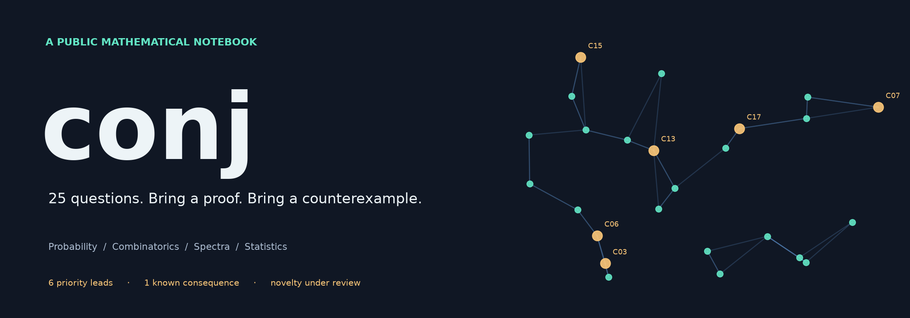

# conj

**A public collection of mathematical conjectures, worked checks, and research leads.**

What survives when a graph loses vertices? How long does a random crossing remember its past? Can the holes in a sumset have a Gaussian shape?

This notebook starts with **25 candidate statements generated with GitHub Copilot**, revised and examined with ChatGPT/Codex. The aim is to turn intriguing questions into precise, falsifiable mathematics—and invite people to improve, solve, or retire them. Every candidate has a formal statement, an illustrated introduction, and a next mathematical step.

**Bring a proof. Bring a counterexample. Bring the paper that already settles it. All three move the project forward.**

[Explore the atlas](docs/atlas/README.md) · [Read the research notebook](main.conjectures.analysis.notes.current.md) · [Browse exact statements](main.conjectures.index.current.md) · [Contribute](CONTRIBUTING.md)

## What is actually known?

| As of 12 October 2026 | Count | Meaning |
|---|---:|---|
| Original candidate slots | 25 | The original collection, with stable C01–C25 IDs |
| Known-theorem consequence | 1 | [C01 has a complete implication proof](main.conjectures.analysis.c01.complete.md) |
| Unresolved in this project | 24 | Initial screening is complete; specialist review is not |
| Priority research leads | 6 | C03, C06, C07, C13, C15, C17—an editorial shortlist |
| Certified new open problems | 0 | Truth, exact novelty, and open status have not been independently established |

**Twenty-four unresolved statements are not twenty-four verified open problems.** Some may already follow from the literature; others may be false or need sharper hypotheses. C02, for example, substantially overlaps a [2026 chemical-metric scaling preprint](https://arxiv.org/abs/2604.14122); its precise normalization and moment claim still need comparison. Keeping these distinctions visible is part of the research.

## Six places to start

These are the strongest provisional leads from our first review. **C17** has a concrete projection mechanism and reproducible experiments. **C06, C07, and C15** have potential connections to noisy spectral methods, incomplete networks, and statistical inference. Their practical usefulness remains to be demonstrated.

Click a card for its exact statement, current obstacle, and full-size image.

<!-- BEGIN PRIORITY -->
<table>
<tr>
<td width="50%" valign="top"><a href="docs/atlas/c03.md">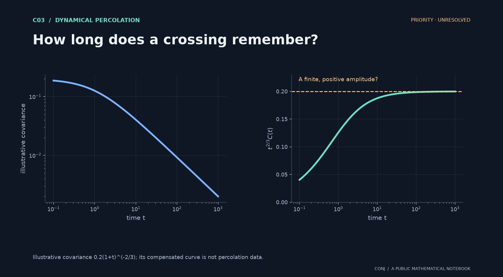</a><br><strong><a href="docs/atlas/c03.md">C03 · How long does a crossing remember?</a></strong><br>Does rescaled crossing memory settle to a finite, positive amplitude?<br><sub>Priority · unresolved</sub></td>
<td width="50%" valign="top"><a href="docs/atlas/c06.md"></a><br><strong><a href="docs/atlas/c06.md">C06 · Do noisy eigenvectors forget?</a></strong><br>Does the whole two-time eigenvector-fidelity field agree with its Gaussian reference?<br><sub>Priority · unresolved</sub></td>
</tr>
<tr>
<td width="50%" valign="top"><a href="docs/atlas/c07.md">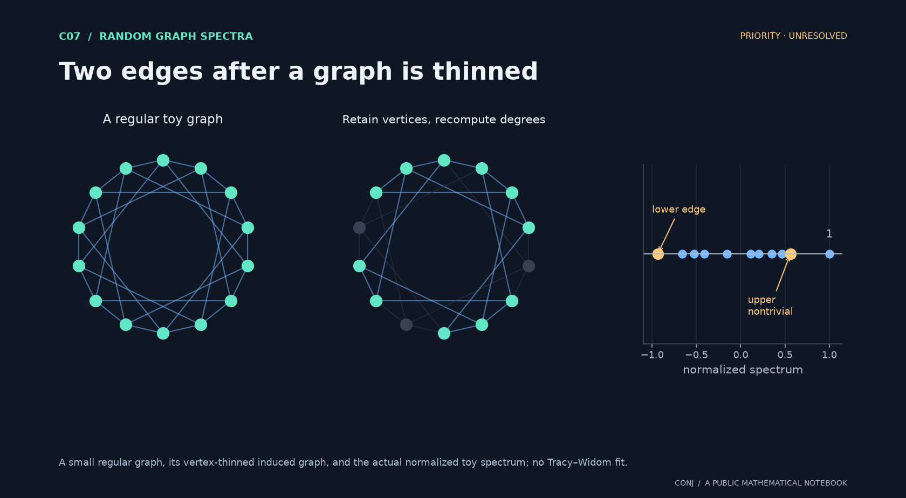</a><br><strong><a href="docs/atlas/c07.md">C07 · Two edges after a graph is thinned</a></strong><br>Do the upper and lower nontrivial spectral edges approach independent Tracy–Widom laws?<br><sub>Priority · unresolved</sub></td>
<td width="50%" valign="top"><a href="docs/atlas/c13.md">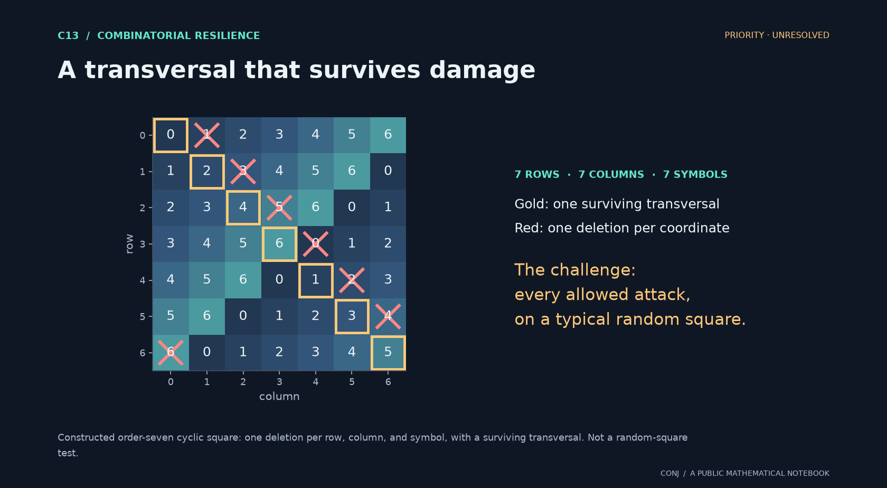</a><br><strong><a href="docs/atlas/c13.md">C13 · A transversal that survives damage</a></strong><br>Can every locally bounded deletion attack leave a transversal in a random Latin square?<br><sub>Priority · unresolved</sub></td>
</tr>
<tr>
<td width="50%" valign="top"><a href="docs/atlas/c15.md"></a><br><strong><a href="docs/atlas/c15.md">C15 · Inference through missing data</a></strong><br>Can one calibrate the largest estimation error while learning an unknown low-rank nuisance?<br><sub>Priority · unresolved</sub></td>
<td width="50%" valign="top"><a href="docs/atlas/c17.md">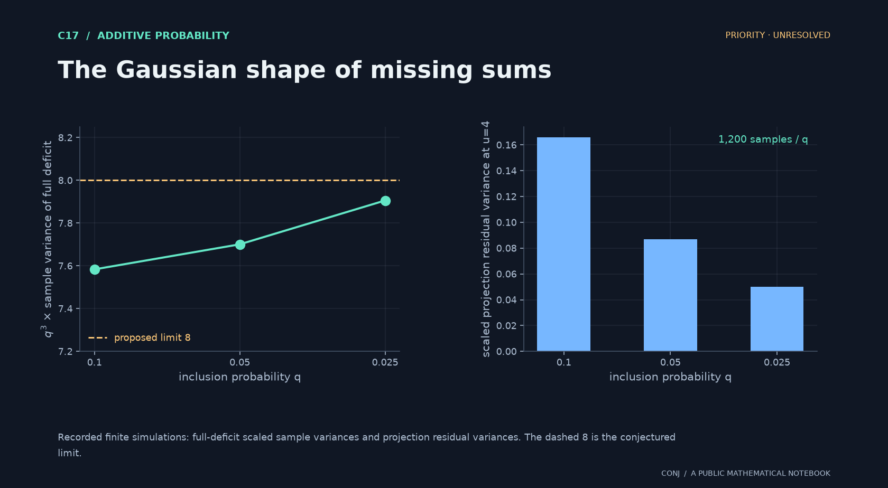</a><br><strong><a href="docs/atlas/c17.md">C17 · The Gaussian shape of missing sums</a></strong><br>Do sumset deficits converge to a Gaussian field with an explicit covariance kernel?<br><sub>Priority · unresolved</sub></td>
</tr>
</table>
<!-- END PRIORITY -->

## A small experiment worth pursuing

C17 predicts that the full deficit of a sparse random sumset has scaled variance tending to **8**. The recorded finite experiment gives:

| Inclusion probability q | Interval size m | Samples | q³ × sample variance of the full deficit | Scaled projection residual variance at u = 4 |
|---:|---:|---:|---:|---:|
| 0.100 | 2,121 | 1,200 | 7.5836 | 0.1657 |
| 0.050 | 14,360 | 1,200 | 7.7007 | 0.0871 |
| 0.025 | 87,091 | 1,200 | 7.9057 | 0.0502 |

The first-order projection suggests a mechanism; the shrinking residual suggests a question worth attacking. **Three finite parameter values do not prove convergence.** A uniform higher-order remainder bound and functional tightness are still missing. See the [recorded observations](main.conjectures.analysis.observations.json), [experiment code](main.conjectures.analysis.experiments.py), and [notebook](main.conjectures.analysis.notes.current.md) for the exact setup and limits.

## The rest of the collection

The remaining nineteen include percolation thresholds, random topology, extreme-value laws, permutation patterns, and partial-order dynamics. C01 stays visible as a worked example of a candidate resolved by existing theorems. C10 and C24 carry higher-risk labels because their proposed fluctuation or relaxation scales need particular scrutiny.

<!-- BEGIN OTHERS -->
<table>
<tr>
<td width="50%" valign="top"><a href="docs/atlas/c01.md">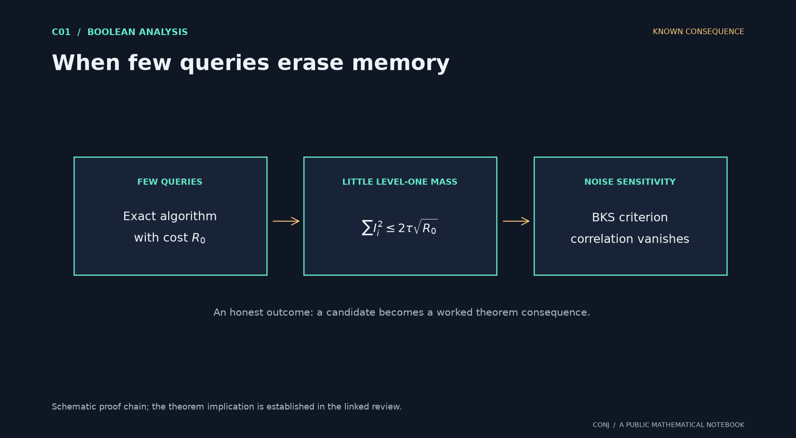</a><br><strong><a href="docs/atlas/c01.md">C01 · When few queries erase memory</a></strong><br>Can an extremely efficient exact decision algorithm coexist with persistent noise correlation?<br><sub>Known consequence</sub></td>
<td width="50%" valign="top"><a href="docs/atlas/c02.md">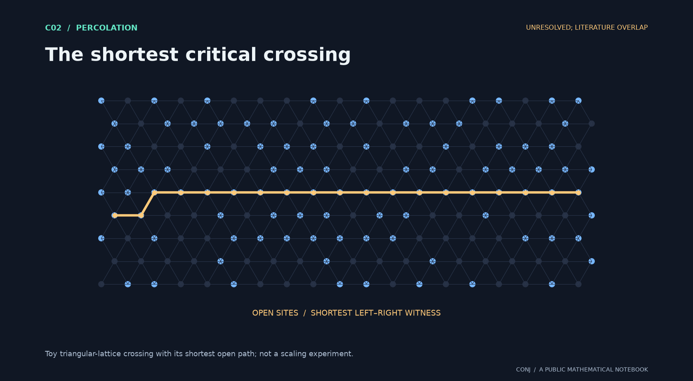</a><br><strong><a href="docs/atlas/c02.md">C02 · The shortest critical crossing</a></strong><br>Does shortest-path length have a nondegenerate limit under an exact power normalization?<br><sub>Unresolved; literature overlap</sub></td>
</tr>
<tr>
<td width="50%" valign="top"><a href="docs/atlas/c04.md"></a><br><strong><a href="docs/atlas/c04.md">C04 · The shape of a threshold</a></strong><br>Is the continuum crossing profile twice continuously differentiable, with positive slope?<br><sub>Unresolved</sub></td>
<td width="50%" valign="top"><a href="docs/atlas/c05.md">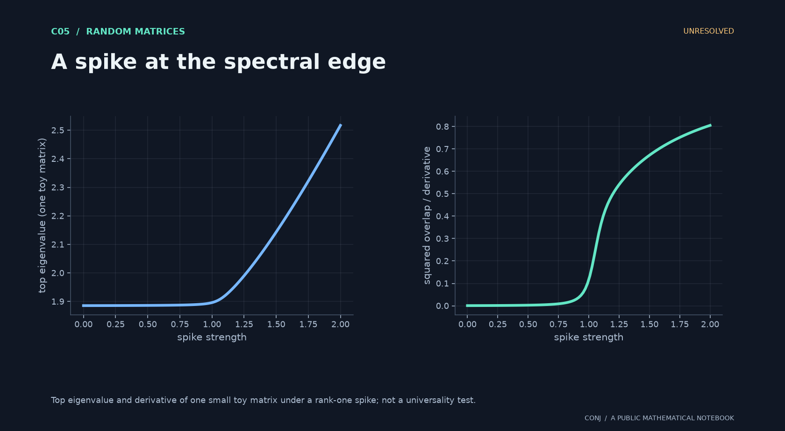</a><br><strong><a href="docs/atlas/c05.md">C05 · A spike at the spectral edge</a></strong><br>Do critical eigenvalue-response curves and their derivatives forget the entry distribution?<br><sub>Unresolved</sub></td>
</tr>
<tr>
<td width="50%" valign="top"><a href="docs/atlas/c08.md"></a><br><strong><a href="docs/atlas/c08.md">C08 · A cascade near its tipping point</a></strong><br>Does a growing-degree activation transition have a calibrated Gaussian profile?<br><sub>Unresolved</sub></td>
<td width="50%" valign="top"><a href="docs/atlas/c09.md">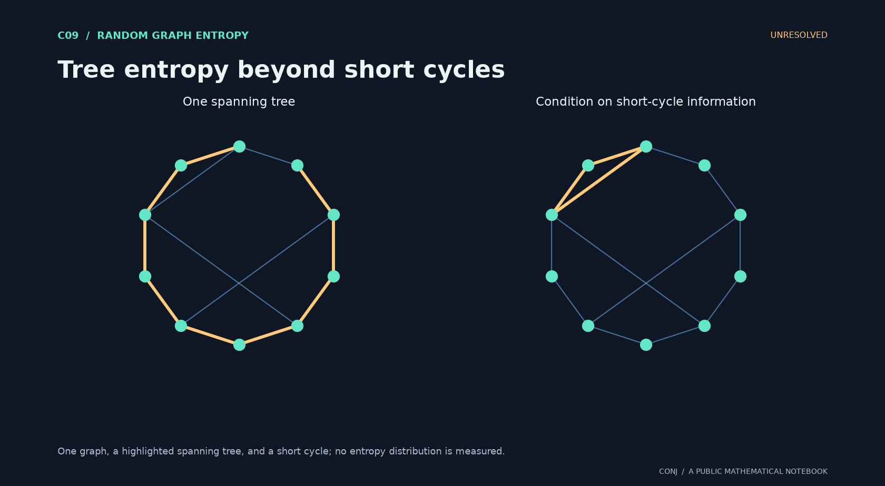</a><br><strong><a href="docs/atlas/c09.md">C09 · Tree entropy beyond short cycles</a></strong><br>After conditioning on more and more short cycles, is the remaining tree entropy Gaussian?<br><sub>Unresolved</sub></td>
</tr>
<tr>
<td width="50%" valign="top"><a href="docs/atlas/c10.md">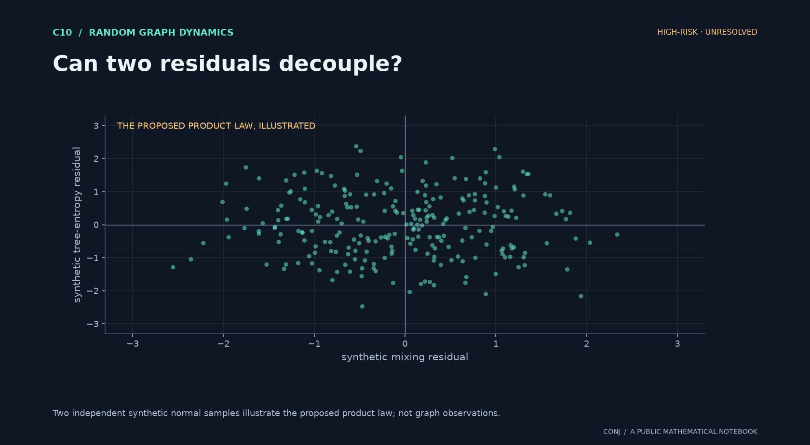</a><br><strong><a href="docs/atlas/c10.md">C10 · Can two residuals decouple?</a></strong><br>Do mixing and spanning-tree entropy have independent Gaussian residuals after local conditioning?<br><sub>High-risk · unresolved</sub></td>
<td width="50%" valign="top"><a href="docs/atlas/c11.md">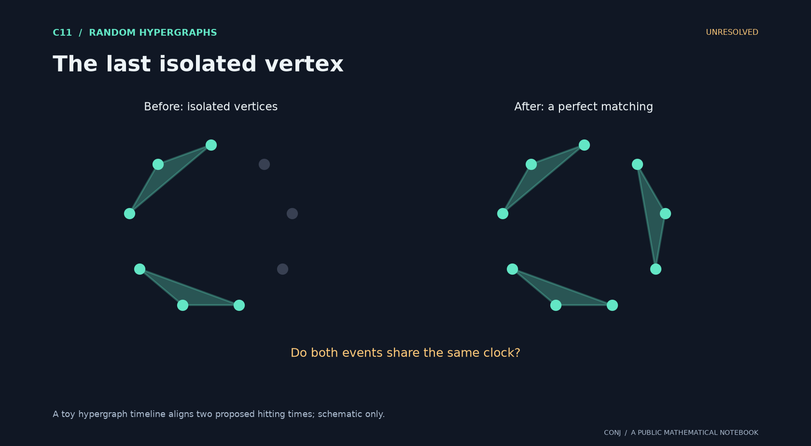</a><br><strong><a href="docs/atlas/c11.md">C11 · The last isolated vertex</a></strong><br>Under balanced nonuniform arrival rates, does a perfect matching arrive exactly when isolation ends?<br><sub>Unresolved</sub></td>
</tr>
<tr>
<td width="50%" valign="top"><a href="docs/atlas/c12.md">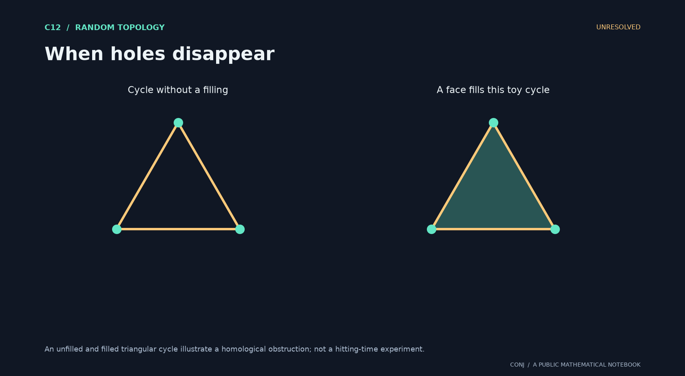</a><br><strong><a href="docs/atlas/c12.md">C12 · When holes disappear</a></strong><br>Does first homology vanish exactly when the final isolated edge disappears?<br><sub>Unresolved</sub></td>
<td width="50%" valign="top"><a href="docs/atlas/c14.md"></a><br><strong><a href="docs/atlas/c14.md">C14 · The final visits on two sides</a></strong><br>Do the two sides of a biregular graph have independent normalized cover-time extremes?<br><sub>Unresolved</sub></td>
</tr>
<tr>
<td width="50%" valign="top"><a href="docs/atlas/c16.md"></a><br><strong><a href="docs/atlas/c16.md">C16 · The last missing sums</a></strong><br>Do the two outermost holes in a sparse random sumset have independent Gumbel limits?<br><sub>Unresolved</sub></td>
<td width="50%" valign="top"><a href="docs/atlas/c18.md"></a><br><strong><a href="docs/atlas/c18.md">C18 · Counting additive collisions</a></strong><br>Does fixed-cardinality additive energy obey a lattice-corrected local central limit law?<br><sub>Unresolved</sub></td>
</tr>
<tr>
<td width="50%" valign="top"><a href="docs/atlas/c19.md">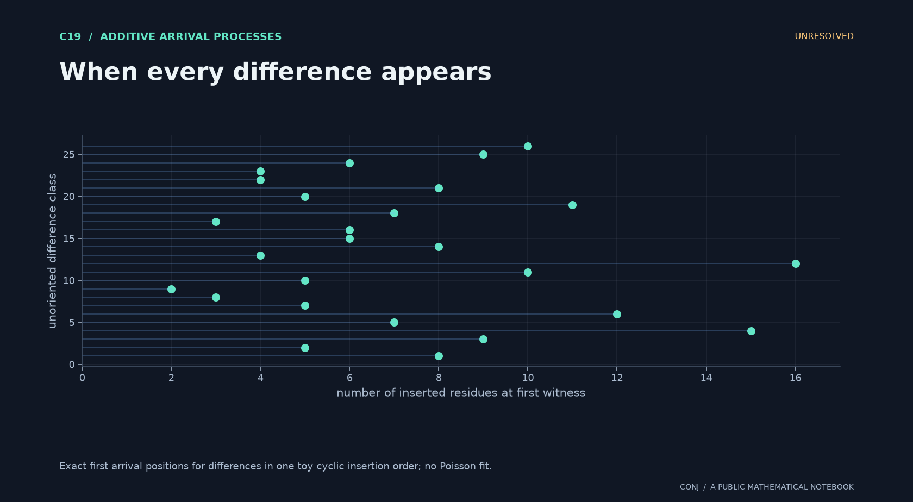</a><br><strong><a href="docs/atlas/c19.md">C19 · When every difference appears</a></strong><br>Do normalized first-witness times for differences form a Poisson point process?<br><sub>Unresolved</sub></td>
<td width="50%" valign="top"><a href="docs/atlas/c20.md"></a><br><strong><a href="docs/atlas/c20.md">C20 · The largest accidental overlap</a></strong><br>Does the largest autocorrelation of a fixed-size random set have a Gumbel law?<br><sub>Unresolved</sub></td>
</tr>
<tr>
<td width="50%" valign="top"><a href="docs/atlas/c21.md"></a><br><strong><a href="docs/atlas/c21.md">C21 · Local peaks, global patterns</a></strong><br>How does conditioning on peaks change the global count of 132 patterns?<br><sub>Unresolved</sub></td>
<td width="50%" valign="top"><a href="docs/atlas/c22.md"></a><br><strong><a href="docs/atlas/c22.md">C22 · What a sparse shuffle changes</a></strong><br>Does the descent response to a sparse reshuffle converge, conditionally, to Brownian motion?<br><sub>Unresolved</sub></td>
</tr>
<tr>
<td width="50%" valign="top"><a href="docs/atlas/c23.md">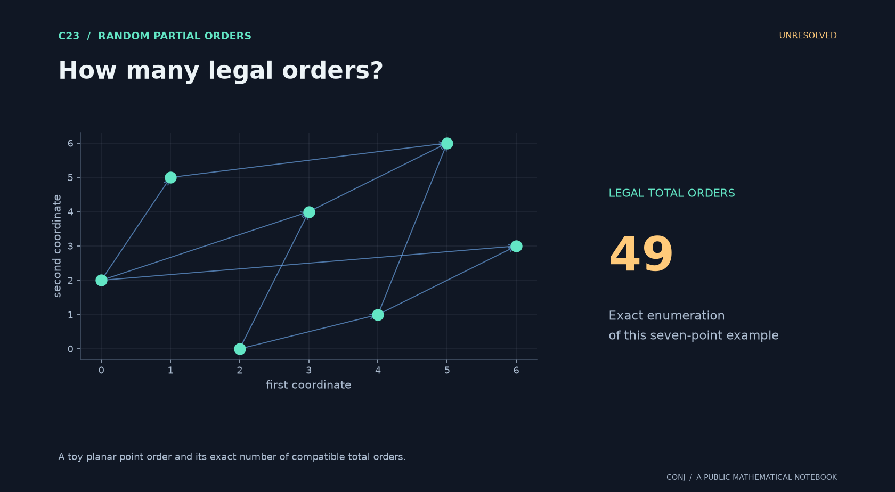</a><br><strong><a href="docs/atlas/c23.md">C23 · How many legal orders?</a></strong><br>Is there a deterministic second-order entropy constant for random planar orders?<br><sub>Unresolved</sub></td>
<td width="50%" valign="top"><a href="docs/atlas/c24.md">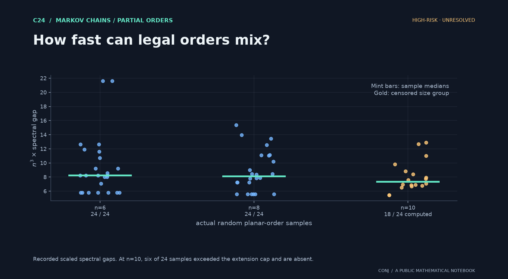</a><br><strong><a href="docs/atlas/c24.md">C24 · How fast can legal orders mix?</a></strong><br>Does the legal adjacent-swap walk have a universal n-cubed relaxation scale?<br><sub>High-risk · unresolved</sub></td>
</tr>
<tr>
<td width="50%" valign="top"><a href="docs/atlas/c25.md">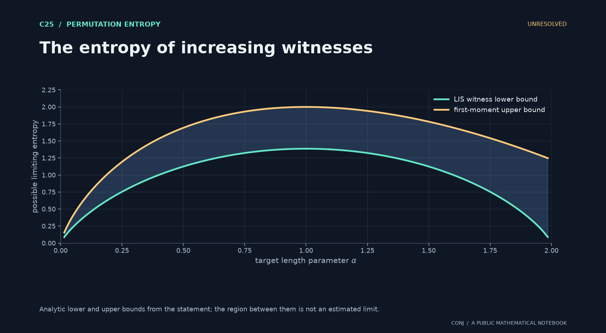</a><br><strong><a href="docs/atlas/c25.md">C25 · The entropy of increasing witnesses</a></strong><br>Do increasing-subsequence counts have a deterministic quenched entropy profile?<br><sub>Unresolved</sub></td>
<td></td>
</tr>
</table>
<!-- END OTHERS -->

## Two directions growing out of the review

[N01 and N02](main.conjectures.discovery.current.md) are separate discovery leads:

- **N01: inhomogeneous sumset fluctuations.** Replace constant inclusion probability by a smooth spatial profile and ask for a corresponding Gaussian covariance kernel.
- **N02: extremes and bulk together.** Ask whether the two missing-sum fronts and the two deficit fields become jointly independent.

Both are preliminary. They are not included in the original 25 or presented as verified new open problems.

## Reproduce the checks and figures

Use Python 3.12 or later. A virtual environment is recommended.

```bash
python -m venv .venv
# Activate .venv using your shell's activation command.
python -m pip install -r requirements.txt
python -c "from pathlib import Path; Path('work').mkdir(exist_ok=True)"

# Check recorded input fingerprints and an exact rational projection identity.
python tools/verify_evidence.py

# Run the original bounded sanity checks across all 25 statements.
python main.conjectures.sanity.py --output work/checks.json

# Rebuild every visual and illustrated introduction.
python tools/build_atlas.py
python tools/check_publication.py

# Longer: reproduce the sumset and actual planar-order experiments.
python main.conjectures.analysis.experiments.py --output work/observations.json
```

The baseline experiments used seed **20261012**, Python **3.14.6**, NumPy **2.5.3**, and SciPy **1.18.1**. Small numerical differences may occur across numerical-library versions. Baseline JSON files retain input hashes and parameters; the commands above write fresh experimental output under `work/`.

The atlas uses seeded, explicitly labeled toy constructions, analytic curves, and recorded data. **Only C17 and C24 plot the recorded research experiments.** Other pictures illustrate definitions or proposed laws; they do not provide numerical support. C24 explicitly marks the six omitted n = 10 samples that exceeded the enumeration cap. Each image has a caption, a [vector counterpart](assets/), and a [provenance manifest](assets/manifest.json).

## Research organization

| Entry point | Purpose |
|---|---|
| [Atlas](docs/atlas/README.md) | Accessible introductions and one visual per original candidate |
| [Statement index](main.conjectures.index.current.md) | Authoritative definitions, quantifiers, and normalizations |
| [Notebook](main.conjectures.analysis.notes.current.md) | Findings, primary-literature comparisons, categories, and next checks |
| [Evidence ledger](main.conjectures.evidence.current.md) | What the computations actually check |
| [C01 proof](main.conjectures.analysis.c01.complete.md) | Complete reduction to known theorems |
| [Discovery lane](main.conjectures.discovery.current.md) | N01–N02, clearly separated from the original collection |
| [Contribution guide](CONTRIBUTING.md) | How to submit a proof, counterexample, reference, or experiment |

Recur is optional. Stable trace IDs connect candidates (`main.conjectures.c17`), findings (`main.conjectures.notes.c17.*`), and illustrated introductions (`main.conjectures.atlas.c17`). Tags distinguish analytic work, literature, computation, and unresolved questions. A trace link locates evidence; it does not prove a claim.

With Recur installed, initialize fresh local discovery lanes without overwriting existing ones:

```bash
python tools/init_recur.py
recur reveal main.conjectures
recur reveal main.conjectures.notes
recur trace-id "main.conjectures.notes.c17.**" --scope "main.conjectures.**" -d . --format full
```

Read the revealed notebook in your editor and record findings there. `.current` is an attention marker, not a declaration that a problem is open. Machine-specific session history and private `.recur/` state are excluded from the public repository.

## Join the investigation

Pick one statement. Check its assumptions. Try to break it. Find its nearest theorem. Then [open an issue](https://github.com/UserLevelUp/conj/issues) with the candidate ID and your argument or source, or submit a pull request with reproducible work.

The collection is intended for mathematical scrutiny. C15's educational motivation is a hypothetical measurement model; no empirical claim about learners follows from it. The AI-assisted origin is disclosed so readers can evaluate the arguments and evidence on their merits.

<!-- publish: main.conjectures.publication public research entry point -->
<!-- consumer: main.conjectures.notes.assessment.priority -->
<!-- consumer: main.conjectures.atlas -->
