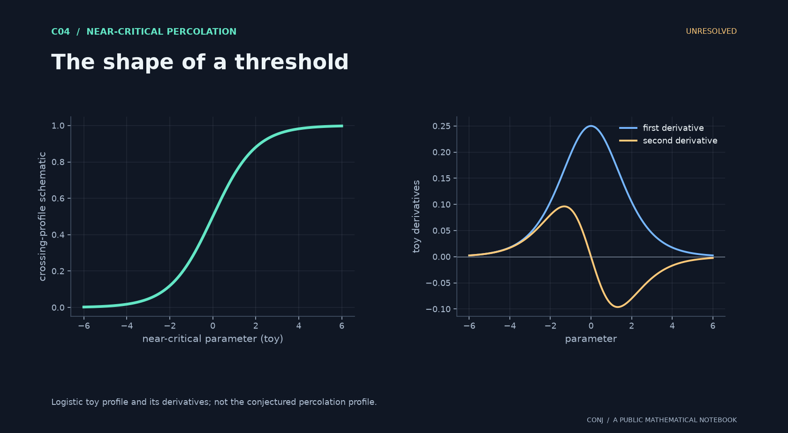

# C04 · The shape of a threshold

**Near-critical percolation · Unresolved**

Is the continuum crossing profile twice continuously differentiable, with positive slope?

*Figure provenance: Logistic toy profile and its derivatives; not the conjectured percolation profile.* [Vector version](../../assets/c04.svg).

Convergence of crossing probabilities alone does not justify differentiating the limiting profile twice.

**Next mathematical step:** Control second derivatives uniformly before interchanging limits.

[Read the exact statement](../../main.conjectures.c04.product-threshold-curvature.current.md) · [Review notebook](../../main.conjectures.analysis.notes.current.md) · [Contribute](../../CONTRIBUTING.md)

The exact hypotheses, definitions, quantifiers, and normalization are in the linked statement. This introduction does not replace them. A priority tag is an editorial judgment; unresolved means unresolved by this project, not verified open in the literature.

[All 25 candidates](README.md) · [Project home](../../README.md)

<!-- consumer: main.conjectures.c04 -->
<!-- publish: main.conjectures.atlas.c04 public illustrated introduction -->
