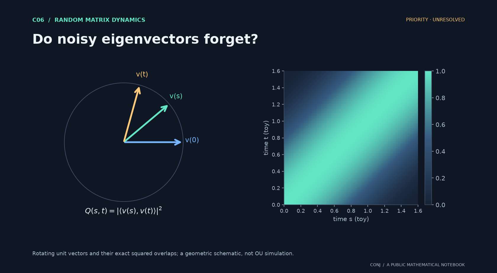

# C06 · Do noisy eigenvectors forget?

**Random matrix dynamics · Priority · unresolved**

Does the whole two-time eigenvector-fidelity field agree with its Gaussian reference?

*Figure provenance: Rotating unit vectors and their exact squared overlaps; a geometric schematic, not OU simulation.* [Vector version](../../assets/c06.svg).

The comparison includes the initial time and the critical n^(-1/3) time scale. It could clarify how sensitive leading spectral directions are to evolving noise.

**Next mathematical step:** Prove tightness and control initial-time memory and tiny gaps.

[Read the exact statement](../../main.conjectures.c06.spectral-resilience.current.md) · [Review notebook](../../main.conjectures.analysis.notes.current.md) · [Contribute](../../CONTRIBUTING.md)

The exact hypotheses, definitions, quantifiers, and normalization are in the linked statement. This introduction does not replace them. A priority tag is an editorial judgment; unresolved means unresolved by this project, not verified open in the literature.

[All 25 candidates](README.md) · [Project home](../../README.md)

<!-- consumer: main.conjectures.c06 -->
<!-- publish: main.conjectures.atlas.c06 public illustrated introduction -->
