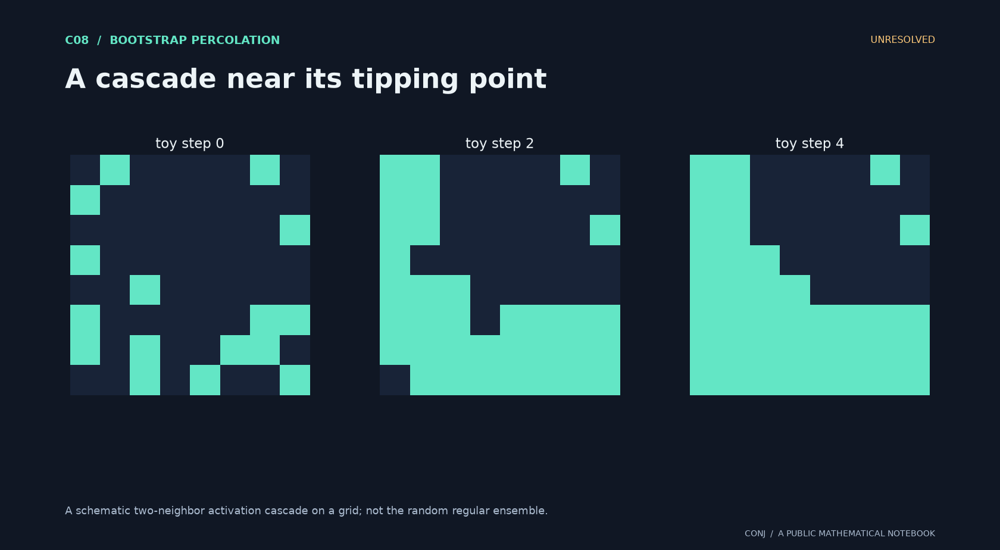

# C08 · A cascade near its tipping point

**Bootstrap percolation · Unresolved**

Does a growing-degree activation transition have a calibrated Gaussian profile?

*Figure provenance: A schematic two-neighbor activation cascade on a grid; not the random regular ensemble.* [Vector version](../../assets/c08.svg).

The tree bifurcation locates a candidate transition; the finite regular graph must supply the correct fluctuation width.

**Next mathematical step:** Identify the regular-ensemble critical variance uniformly as degree grows.

[Read the exact statement](../../main.conjectures.c08.bootstrap-nonbacktracking.current.md) · [Review notebook](../../main.conjectures.analysis.notes.current.md) · [Contribute](../../CONTRIBUTING.md)

The exact hypotheses, definitions, quantifiers, and normalization are in the linked statement. This introduction does not replace them. A priority tag is an editorial judgment; unresolved means unresolved by this project, not verified open in the literature.

[All 25 candidates](README.md) · [Project home](../../README.md)

<!-- consumer: main.conjectures.c08 -->
<!-- publish: main.conjectures.atlas.c08 public illustrated introduction -->
