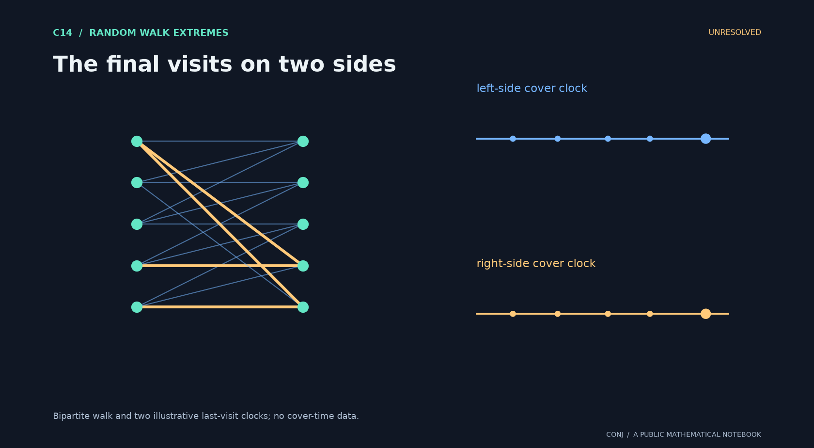

# C14 · The final visits on two sides

**Random walk extremes · Unresolved**

Do the two sides of a biregular graph have independent normalized cover-time extremes?

*Figure provenance: Bipartite walk and two illustrative last-visit clocks; no cover-time data.* [Vector version](../../assets/c14.svg).

The two stationary visit rates determine different natural clocks; joint avoidance probabilities are the obstacle.

**Next mathematical step:** Control short-return clusters and joint late-vertex events.

[Read the exact statement](../../main.conjectures.c14.neighborhood-cover-connectivity.current.md) · [Review notebook](../../main.conjectures.analysis.notes.current.md) · [Contribute](../../CONTRIBUTING.md)

The exact hypotheses, definitions, quantifiers, and normalization are in the linked statement. This introduction does not replace them. A priority tag is an editorial judgment; unresolved means unresolved by this project, not verified open in the literature.

[All 25 candidates](README.md) · [Project home](../../README.md)

<!-- consumer: main.conjectures.c14 -->
<!-- publish: main.conjectures.atlas.c14 public illustrated introduction -->
