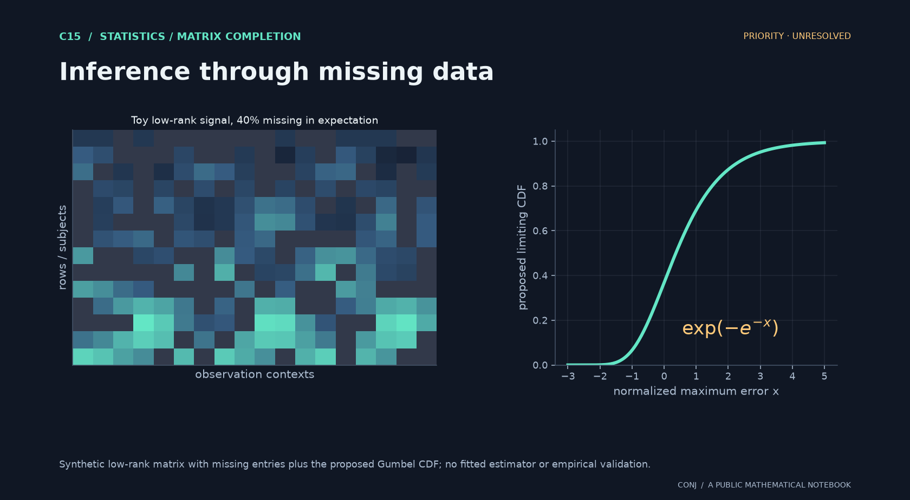

# C15 · Inference through missing data

**Statistics / matrix completion · Priority · unresolved**

Can one calibrate the largest estimation error while learning an unknown low-rank nuisance?

*Figure provenance: Synthetic low-rank matrix with missing entries plus the proposed Gumbel CDF; no fitted estimator or empirical validation.* [Vector version](../../assets/c15.svg).

The proposed efficient Gumbel law is uniform over a specified matrix class. Its potential statistical value is simultaneous uncertainty calibration. The motivating education interpretation remains hypothetical.

**Next mathematical step:** Obtain a uniform debiasing remainder small enough for extreme tails and compare existing simultaneous-inference results.

[Read the exact statement](../../main.conjectures.c15.education-attention-alignment.current.md) · [Review notebook](../../main.conjectures.analysis.notes.current.md) · [Contribute](../../CONTRIBUTING.md)

The exact hypotheses, definitions, quantifiers, and normalization are in the linked statement. This introduction does not replace them. A priority tag is an editorial judgment; unresolved means unresolved by this project, not verified open in the literature.

[All 25 candidates](README.md) · [Project home](../../README.md)

<!-- consumer: main.conjectures.c15 -->
<!-- publish: main.conjectures.atlas.c15 public illustrated introduction -->
