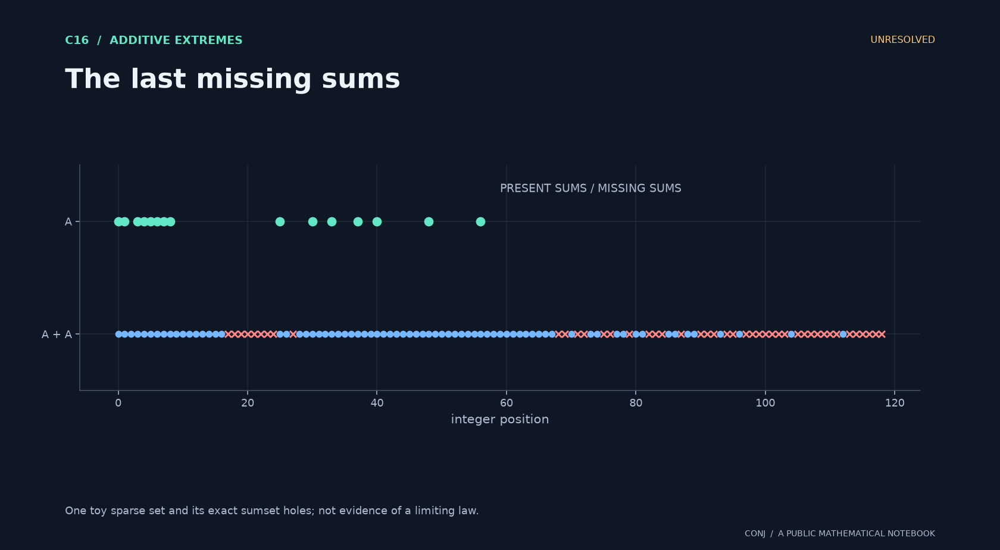

# C16 · The last missing sums

**Additive extremes · Unresolved**

Do the two outermost holes in a sparse random sumset have independent Gumbel limits?

*Figure provenance: One toy sparse set and its exact sumset holes; not evidence of a limiting law.* [Vector version](../../assets/c16.svg).

Missing-sum events share input sites, making the extreme law a problem in dependent rare events.

**Next mathematical step:** Estimate joint missing-sum probabilities through unions of matchings.

[Read the exact statement](../../main.conjectures.c16.energy-popular-sums.current.md) · [Review notebook](../../main.conjectures.analysis.notes.current.md) · [Contribute](../../CONTRIBUTING.md)

The exact hypotheses, definitions, quantifiers, and normalization are in the linked statement. This introduction does not replace them. A priority tag is an editorial judgment; unresolved means unresolved by this project, not verified open in the literature.

[All 25 candidates](README.md) · [Project home](../../README.md)

<!-- consumer: main.conjectures.c16 -->
<!-- publish: main.conjectures.atlas.c16 public illustrated introduction -->
