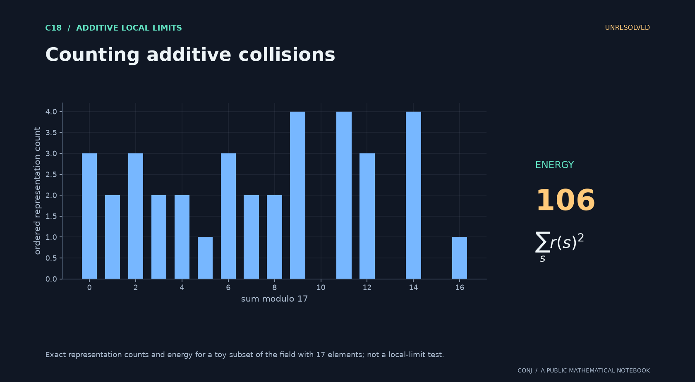

# C18 · Counting additive collisions

**Additive local limits · Unresolved**

Does fixed-cardinality additive energy obey a lattice-corrected local central limit law?

*Figure provenance: Exact representation counts and energy for a toy subset of the field with 17 elements; not a local-limit test.* [Vector version](../../assets/c18.svg).

A global Gaussian approximation is insufficient: individual atom probabilities and the correct lattice must be resolved.

**Next mathematical step:** Compute conditional variance and establish lattice anti-concentration.

[Read the exact statement](../../main.conjectures.c18.energy-progression-witness.current.md) · [Review notebook](../../main.conjectures.analysis.notes.current.md) · [Contribute](../../CONTRIBUTING.md)

The exact hypotheses, definitions, quantifiers, and normalization are in the linked statement. This introduction does not replace them. A priority tag is an editorial judgment; unresolved means unresolved by this project, not verified open in the literature.

[All 25 candidates](README.md) · [Project home](../../README.md)

<!-- consumer: main.conjectures.c18 -->
<!-- publish: main.conjectures.atlas.c18 public illustrated introduction -->
