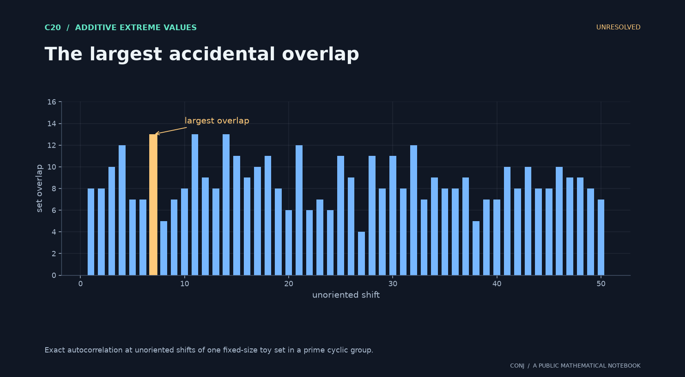

# C20 · The largest accidental overlap

**Additive extreme values · Unresolved**

Does the largest autocorrelation of a fixed-size random set have a Gumbel law?

*Figure provenance: Exact autocorrelation at unoriented shifts of one fixed-size toy set in a prime cyclic group.* [Vector version](../../assets/c20.svg).

Overlaps at different shifts are dependent; the normalization must account for the relevant arithmetic classes.

**Next mathematical step:** Prove joint moderate deviations at the extreme-value scale.

[Read the exact statement](../../main.conjectures.c20.fourier-popular-differences.current.md) · [Review notebook](../../main.conjectures.analysis.notes.current.md) · [Contribute](../../CONTRIBUTING.md)

The exact hypotheses, definitions, quantifiers, and normalization are in the linked statement. This introduction does not replace them. A priority tag is an editorial judgment; unresolved means unresolved by this project, not verified open in the literature.

[All 25 candidates](README.md) · [Project home](../../README.md)

<!-- consumer: main.conjectures.c20 -->
<!-- publish: main.conjectures.atlas.c20 public illustrated introduction -->
