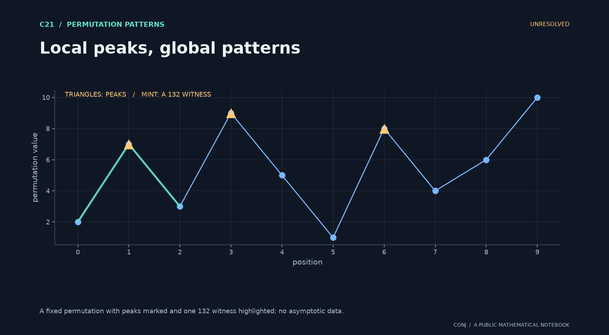

# C21 · Local peaks, global patterns

**Permutation patterns · Unresolved**

How does conditioning on peaks change the global count of 132 patterns?

*Figure provenance: A fixed permutation with peaks marked and one 132 witness highlighted; no asymptotic data.* [Vector version](../../assets/c21.svg).

The proposed analytic response appears at order n squared, below the leading count scale.

**Next mathematical step:** Analyze the rare-conditioning tilt and its second-order correction.

[Read the exact statement](../../main.conjectures.c21.peaks-pattern-emergence.current.md) · [Review notebook](../../main.conjectures.analysis.notes.current.md) · [Contribute](../../CONTRIBUTING.md)

The exact hypotheses, definitions, quantifiers, and normalization are in the linked statement. This introduction does not replace them. A priority tag is an editorial judgment; unresolved means unresolved by this project, not verified open in the literature.

[All 25 candidates](README.md) · [Project home](../../README.md)

<!-- consumer: main.conjectures.c21 -->
<!-- publish: main.conjectures.atlas.c21 public illustrated introduction -->
