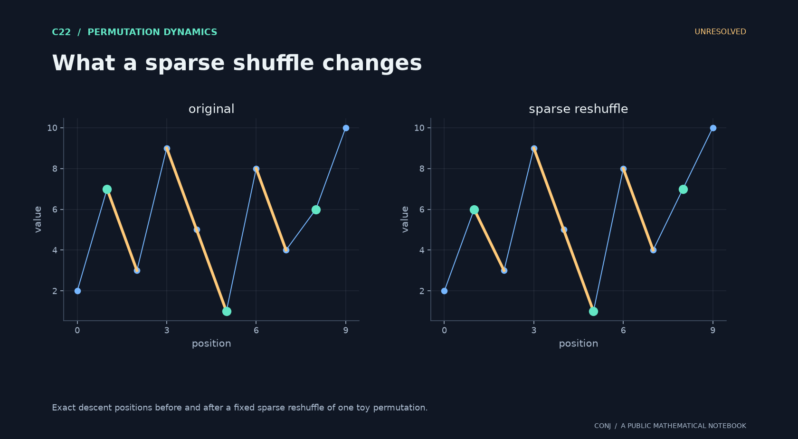

# C22 · What a sparse shuffle changes

**Permutation dynamics · Unresolved**

Does the descent response to a sparse reshuffle converge, conditionally, to Brownian motion?

*Figure provenance: Exact descent positions before and after a fixed sparse reshuffle of one toy permutation.* [Vector version](../../assets/c22.svg).

The target covariance is min(s,t)/3. Quenched control and adjacent-site errors must hold throughout the specified sparse regime.

**Next mathematical step:** Bound centered drift and adjacency effects beyond the simplest sparse subregime.

[Read the exact statement](../../main.conjectures.c22.resampling-descents.current.md) · [Review notebook](../../main.conjectures.analysis.notes.current.md) · [Contribute](../../CONTRIBUTING.md)

The exact hypotheses, definitions, quantifiers, and normalization are in the linked statement. This introduction does not replace them. A priority tag is an editorial judgment; unresolved means unresolved by this project, not verified open in the literature.

[All 25 candidates](README.md) · [Project home](../../README.md)

<!-- consumer: main.conjectures.c22 -->
<!-- publish: main.conjectures.atlas.c22 public illustrated introduction -->
