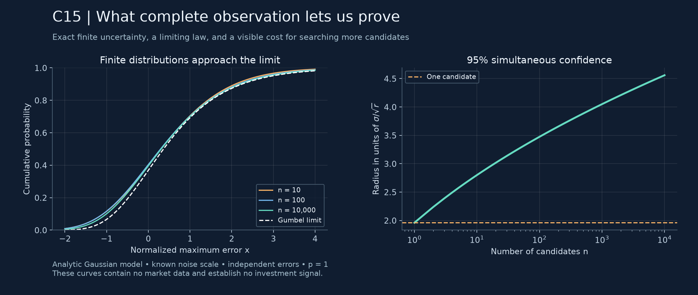

# C15: an exact subset, and the gap between inference and prediction

**Version 0.2.0 · 12 October 2026 · Public research note**

**Disposition:** the fully observed subset of [C15](main.conjectures.c15.education-attention-alignment.current.md)
is proved below. The missing-data result in Section 2 supplies the nuisance
matrix to the estimator and is only an oracle benchmark. Full C15 remains
unresolved. These arguments are elementary consequences of Gaussian maxima,
concentration, and simultaneous coverage; no novelty is claimed.

The motivating decision question has two requirements: positive expected
return after costs, and a small probability of a specified loss. Section 3
proves a sufficient condition **inside an explicitly assumed stochastic
model**. It neither identifies actual investment dates nor establishes that
financial returns satisfy the assumptions. The paper and generic calculations
are public; no fitted strategy or current investment signals are provided.



*Analytic curves, not market observations or simulation evidence. The left
panel compares finite Gaussian maxima with their limiting distribution. The
right shows how searching more candidates widens simultaneous intervals.*
[Figure producer](tools/build_c15_figure.py) · [provenance](assets/c15-subset.manifest.json).

## 1. Complete observations: an exact theorem

Let $n,r\ge1$, $\sigma>0$ be known, and observe

$$Y_{ij}=\theta_i+B_{ij}+\varepsilon_{ij},\qquad
\sum_{j=1}^r B_{ij}=0,\qquad
\varepsilon_{ij}\stackrel{\mathrm{iid}}{\sim}N(0,\sigma^2).$$

The parameters $\theta,B$ are deterministic. C15 has $B=UV^T$ and
$V^T\mathbf1_r=0$, which gives the displayed centering. Define
$\widehat\theta_i=r^{-1}\sum_jY_{ij}$. This takes $O(nr)$ operations and
does not require $B$, its factors, or its rank.

**Theorem 1.** For every such $\theta,B$, the variables
$Z_i=\sqrt r(\widehat\theta_i-\theta_i)/\sigma$ are independent standard
normals. Consequently, for $u\ge0$,

$$\Pr\!\left\{\max_{i\le n}|Z_i|\le u\right\}
=[2\Phi(u)-1]^n.\tag{1}$$

For any $0<\alpha<1$, set

$$q_{n,\alpha}=\Phi^{-1}\!\left(\frac{1+(1-\alpha)^{1/n}}2\right),
\qquad h=\frac{\sigma}{\sqrt r}q_{n,\alpha}.\tag{2}$$

Then $\Pr\{\forall i:\ |\widehat\theta_i-\theta_i|\le h\}=1-\alpha$
exactly. If $a_N=\sqrt{2\log N}$ and
$b_N=a_N-(\log\log N+\log(4\pi))/(2a_N)$, then, as $n\to\infty$,

$$\Pr\!\left\{a_{2n}\left(\max_i|Z_i|-b_{2n}\right)\le x\right\}
\longrightarrow \exp(-e^{-x})\qquad(x\in\mathbb R).\tag{3}$$

The convergence is uniform over C15's matrix class because the finite
distribution is identical for every admissible matrix. In particular this
proves C15 with $p=1$ and comparable $n,r\to\infty$.

**Proof.** Centering cancels $B$ exactly, leaving
$\widehat\theta_i-\theta_i=r^{-1}\sum_j\varepsilon_{ij}$.
Gaussian sums in distinct rows use disjoint independent errors. This proves
the first assertion, (1), and (2).

For completeness, write $\bar\Phi=1-\Phi$ and let $\phi$ be the standard
normal density. Integration by parts gives, for $u>0$,

$$\bar\Phi(u)=\frac{\phi(u)}u-\int_u^\infty\frac{\phi(v)}{v^2}\,dv,
\qquad \frac{u\phi(u)}{1+u^2}\le\bar\Phi(u)\le\frac{\phi(u)}u.$$

Thus $\bar\Phi(u)\sim\phi(u)/u$. Put $N=2n$ and
$u_N=b_N+x/a_N$. Direct expansion yields

$$u_N^2=2\log N-\log\log N-\log(4\pi)+2x+o(1),
\qquad N\bar\Phi(u_N)\longrightarrow e^{-x}.$$

Since $u_N>0$ eventually, (1) is
$(1-2\bar\Phi(u_N))^n$. Taking logarithms proves (3). $\square$

**Nonvacuity and scope.** For even $n=r$, let $u,v$ be balanced vectors of
$\pm1$, and take $M=\mathbf1\mathbf1^T+uv^T$. Its rank is two, both
nonzero singular values equal $n$, each leverage score equals $2/n$, and its
row space contains $\mathbf1$. This is an admissible C15 sequence for
compatible fixed constants, with $p=1$. The proof above actually needs none
of the rank, incoherence, or singular-value restrictions. Unknown $\sigma$,
correlated errors, or estimating context centering would require new arguments.

The exact formula (2) is preferable to the Gumbel approximation for finite
samples. Numerical agreement with (3) is illustration, not its proof.

## 2. Missing observations with an oracle nuisance matrix

Now reveal entries through independent Bernoulli-$p$ masks $\delta_{ij}$,
independent of the Gaussian errors. **Assume $B$ is supplied exactly.** Let
$N_i=\sum_j\delta_{ij}$. On $H=\{\min_iN_i>0\}$ define

$$\widetilde\theta_i=\frac1{N_i}\sum_{j:\delta_{ij}=1}(Y_{ij}-B_{ij}).$$

**Proposition 2.** Conditional on any mask in $H$, the variables
$\sqrt{N_i}(\widetilde\theta_i-\theta_i)/\sigma$ are independent standard
normals. Equations (1) and (2) hold with row-specific radii
$h_i=\sigma q_{n,\alpha}/\sqrt{N_i}$. Also
$\Pr(H^c)\le n(1-p)^r$. If $n\to\infty$ and $pr/\log^3n\to\infty$, then the Gumbel
limit also holds with the common normalization $\sqrt{pr}/\sigma$.
Define the estimator arbitrarily on $H^c$ for this last assertion.

**Proof.** Conditional on the mask, each residual average is a sum of
$N_i$ independent Gaussian errors. A union bound gives the empty-row bound.
Write $m=pr$ and $\eta=3\sqrt{\log n/m}$. For large $n$, $0<\eta<1$;
the binomial Chernoff bound gives

$$\Pr\!\left\{\max_i|N_i/m-1|>\eta\right\}
\le2n\exp(-m\eta^2/3)=2n^{-2}.$$

On its complement, $H$ holds and
$\max_i|\sqrt{m/N_i}-1|=O(\eta)$. The conditional Gaussian law gives
$\max_i|Z_i|=O_{\Pr}(\sqrt{\log n})$. Hence replacing $Z_i$ by
$\sqrt{m/N_i}Z_i$ changes the maximum, after multiplication by $a_{2n}$,
by $O_{\Pr}(\eta\log n)=o_{\Pr}(1)$. Theorem 1 and Slutsky's theorem
finish the proof. $\square$

This does **not** cover estimating $B$ from the incomplete matrix. In
particular, substituting a fitted low-rank matrix for the oracle does not
inherit the exact Gaussian law. Uniform control of that estimation remainder
at the extreme-value scale remains the central C15 obstacle.

## 3. A sufficient condition for both decision objectives

Here the candidates may represent hypothetical investment rules. This is a
separate probabilistic application, not a consequence of relabeling learners
as securities. All quantities below refer to one specified holding horizon;
endpoint loss is different from maximum drawdown during that horizon.

Let $\mathcal F_t$ contain information available at scheduled decision time
$t$. There are finitely many candidates at each time and at most countably
many times. Assume the following hypotheses.

1. **Simultaneous inference:** estimates and radii measurable at $t$ obey
   $\Pr(G)\ge1-\alpha$, where
   $G=\{\theta_{i,t}\ge\widehat\theta_{i,t}-h_{i,t}\text{ for every }i,t\}$.
   The historical targets $\theta_{i,t}$ must be defined before inspection.
2. **Transfer to future means:** for gross future return $R_{i,t}$ with
   conditional mean $\mu_{i,t}=\mathbb E[R_{i,t}\mid\mathcal F_t]$, a
   known nonnegative, $\mathcal F_t$-measurable bound $B_{i,t}$ satisfies
   $\mu_{i,t}\ge\theta_{i,t}-B_{i,t}$ almost surely.
3. **Future downside tails:** a known positive, finite,
   $\mathcal F_t$-measurable scale $\nu_{i,t}$ satisfies, for every $\lambda\ge0$,
   $\mathbb E[\exp(-\lambda(R_{i,t}-\mu_{i,t}))\mid\mathcal F_t]
   \le\exp(\lambda^2\nu_{i,t}^2/2)$ almost surely.
4. **Costs:** actual nonnegative costs $C_{i,t}$ obey $C_{i,t}\le c_{i,t}$
   almost surely for a known, finite, nonnegative bound $c_{i,t}$ measurable
   at $t$. Define net return $X_{i,t}=R_{i,t}-C_{i,t}$.

Neither an estimated historical volatility nor an attractive backtest proves
hypotheses 2 or 3. Their validity is an additional assumption. C15's iid
Gaussian observation model itself also needs justification in any application.

Fix a tolerated endpoint loss $\ell\ge0$ and future tail probability
$0<\beta<1$. For each candidate and time define

$$L_{i,t}=\widehat\theta_{i,t}-h_{i,t}-B_{i,t}-c_{i,t}.$$

Accept a candidate only if both

$$L_{i,t}>0,
\qquad L_{i,t}+\ell\ge\nu_{i,t}\sqrt{2\log(1/\beta)}.\tag{4}$$

**Proposition 3.** Under hypotheses 1–4, with probability at least $1-\alpha$,
every accepted pair $(i,t)$ satisfies

$$\mathbb E[X_{i,t}\mid\mathcal F_t]>0,
\qquad \Pr\{X_{i,t}<-\ell\mid\mathcal F_t\}\le\beta.\tag{5}$$

Any selection among the accepted candidates inherits this simultaneous
statement. This is a guarantee about conditional model quantities on an
inference event, not a guarantee that accepted investments realize gains.

**Proof.** On $G$, hypotheses 2 and 4 give
$\mu_{i,t}-c_{i,t}\ge L_{i,t}$ and
$\mathbb E[X_{i,t}\mid\mathcal F_t]\ge L_{i,t}$.
Conditional Markov's inequality applied to hypothesis 3, followed by
minimization over $\lambda\ge0$, gives
$\Pr\{R_{i,t}-\mu_{i,t}<-d\mid\mathcal F_t\}
\le\exp(-d^2/(2\nu_{i,t}^2))$ for $d>0$.
Because $X_{i,t}\ge R_{i,t}-c_{i,t}$, on $G$ an accepted pair therefore has

$$\Pr\{X_{i,t}<-\ell\mid\mathcal F_t\}
\le\exp\!\left(-\frac{(L_{i,t}+\ell)^2}{2\nu_{i,t}^2}\right)\le\beta.$$

Equation (4) also gives positive conditional expected net return. All
inequalities hold simultaneously on $G$, proving the claim. $\square$

**Two different uncertainties.** $\alpha$ controls inference failure;
$\beta$ bounds future loss probability under the conditional model. Even
when inference succeeds, losses remain possible. The theorem does not
automatically give a $\beta$ loss rate conditional on having passed a rare
screen. For a fixed pair with acceptance event $A$, let $D$ be the event that
its conditional loss probability exceeds $\beta$. Since
$\Pr(A\cap D)\le\alpha$, conditioning first on $\mathcal F_t$ gives

$$\Pr(A\cap\{X<-\ell\})\le\beta\Pr(A)+\alpha.$$

If $\Pr(A)>0$, this only implies
$\Pr(X<-\ell\mid A)\le\min(1,\beta+\alpha/\Pr(A))$.
No independence between candidates or successive future returns is claimed.
No bound on cumulative trading losses or portfolio drawdown is established.

### Repeated inspection and a concrete sufficient historical model

At a single fixed look satisfying Theorem 1, use (2). For predetermined
looks with individually valid simultaneous intervals at levels
$1-\alpha_t$, choose deterministic $\alpha_t>0$ with
$\sum_t\alpha_t\le\alpha$. A union bound supplies hypothesis 1, without
requiring independence across looks. For example,
$\alpha_t=6\alpha/(\pi^2t^2)$ for $t=1,2,\ldots$ is sufficient.
One can stop at a data-dependent member of this already covered schedule.

Changing the candidate family after seeing results, fitting a nuisance matrix,
or searching extra unbudgeted windows does not inherit this guarantee.
Candidate construction needs independent training or an appropriate adaptive
inference argument. This simple error allocation is conservative; it is not
a new confidence-sequence method.

To see nonvacuity, take the historical Gaussian model in Theorem 1 and,
independently of that history, future Gaussian returns with conditional means
$\mu_i=\theta_i$ and known scales $\nu_i$. Set $B_i=0$ and take fixed costs
$c_i$. All four hypotheses hold at one look. Sufficiently large positive
$\theta_i$ make (4) hold with probability tending to one as $r\to\infty$,
provided their net means exceed the tail threshold. This is a synthetic
example, not a calibration to markets.

## 4. Why history alone cannot establish future safety

**Proposition 4 (need for a transfer restriction).** Consider any rule whose
acceptance event depends only on the observed history and has positive
probability of acceptance. Without restrictions on future returns, there
exist two processes with exactly the same history distribution but opposing
future safety properties.

**Proof.** Give both processes the same history distribution. In one, set
future net return deterministically to $+a$; in the other, set it to $-a$,
where $a>\ell$. Acceptance has the same positive probability under each
process. In the second, conditional expected net return is negative and
conditional probability of loss beyond $\ell$ is one, on every history.
No history-only rule that sometimes accepts can certify (5) uniformly over
these unrestricted processes. $\square$

Changing regimes, dependence, heavy tails, uncertain costs, and market impact
are concrete ways the proposed transfer and tail assumptions can fail.
Keeping a fitted rule private does not prove those assumptions or remove
market impact. Publication of a mathematical method and disclosure of a
particular investor's positions are separate decisions.

## 5. Relation to existing work and what remains open here

- [Xia and Yuan, *Statistical Inferences of Linear Forms for Noisy Matrix Completion*, Theorem 1](https://arxiv.org/pdf/1909.00116)
  establish asymptotic normality for individual linear forms under specified
  conditions. That theorem is relevant to C15's nuisance estimation, but does
  not by itself establish the uniform maximum law asked for here.
- [Howard, Ramdas, McAuliffe and Sekhon, *Time-uniform, nonparametric, nonasymptotic confidence sequences*, Sections 1–2](https://arxiv.org/pdf/1810.08240)
  develop time-uniform inference using exponential supermartingales. Their
  results are substantially more general than the elementary allocation above.
  Coverage of an historical or running mean still needs a transfer assumption
  before being interpreted as a statement about a future conditional mean.
- [Athey, Bayati, Doudchenko, Imbens and Khosravi, *Matrix Completion Methods for Causal Panel Data Models*](https://arxiv.org/abs/1710.10251)
  use observed untreated outcomes to impute counterfactual panel outcomes.
  This supplies a connection to econometric matrix completion, not a theorem
  about timing investments. Its abstract and publication record were checked;
  this note does not claim a theorem-by-theorem comparison with that paper.
- The [project notebook](main.conjectures.analysis.notes.current.md) also
  records existing simultaneous-inference literature. A full novelty review
  of C15 remains outstanding.

The next mathematical task is to replace Proposition 2's oracle by an
implementable estimator and uniformly control its error at the scale required
by the maximum. The separate empirical task is to test prospective calibration
on untouched chronological data, account for costs and dependence, and compare
against simple baselines. Neither task has been completed by this note.

## 6. Reproduction and evidence boundaries

```powershell
python -m unittest discover -s tests -v
python tools/check_c15.py --output work/c15-checks.json
python tools/check_c15.py --verify docs/c15-checks.json
# Figure regeneration needs the repository requirements, including matplotlib:
python tools/build_c15_figure.py
```

[Recorded numerical checks](docs/c15-checks.json) bind the statement, paper,
implementation, tests, and figure producer to SHA-256 hashes. Deterministic
calculations check the finite formulas and exhibit failures when correlation
or centering assumptions are dropped. They do not validate market forecasts.
The mathematical arguments above, rather than test success, establish the
scoped results. The full C15 candidate retains its original bytes and status.

defines: main.conjectures.analysis.c15.subset scoped proof and application review
publish: main.conjectures.analysis.c15.full-observation exact law and Gumbel limit
publish: main.conjectures.analysis.c15.oracle known-nuisance missing-data benchmark
publish: main.conjectures.analysis.c15.risk-screen conditional two-objective rule
publish: main.conjectures.analysis.c15.transfer necessity of future restrictions
consumer: main.conjectures.c15
consumer: main.conjectures.category.kind.proof
consumer: main.conjectures.category.status.implied
